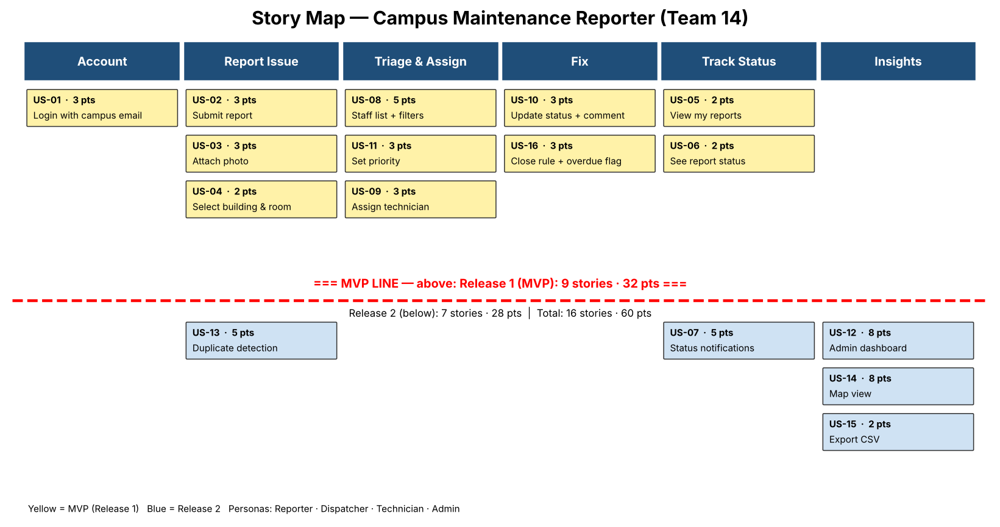

# User Stories — Campus Maintenance Reporter

**Team 14 — Group 2 — Project #2: Campus Maintenance Reporter**

| Name | ID | Role |
|---|---|---|
| Mahmoud Mohamed | 192300395 | Product Owner |
| Ahmed Ehab Makram | 192300399 | Scrum Master |
| Mohamed Osama | 192300376 | Developer |
| Hisham Magdy | 192300419 | Developer |
| Mahmoud Ashour | 192300380 | Developer |

**Product vision:** A web/mobile app where students and staff report campus maintenance faults (projectors, ACs, lights, leaks) with photo and location, and the facilities dispatcher prioritises, assigns and tracks them until a technician fixes them.

**Personas:** Reporter (student/staff) · Facilities Dispatcher · Technician · Admin

**Status life-cycle:** New → Assigned → In Progress → Fixed

**Key rule:** A report cannot be closed until the technician marks it Fixed; an *Urgent* report must be assigned within 2 hours, otherwise it is flagged **Overdue**.

## Story Map

**MVP line:** everything above the line is Release 1 (MVP): US-01–06, 08, 09, 10, 11, 16 = **32 pts**. Release 2 (below the line): US-07, 12, 13, 14, 15 = **28 pts**.

## Stories

| ID | Story | Acceptance Criteria | Points | Release |
|---|---|---|---|---|
| US-01 | As a user, I want to log in with my campus email so that my reports are linked to me. | Only campus-domain emails accepted; logout works; invalid login shows error. | 3 | MVP |
| US-02 | As a reporter, I want to submit a report with title, description and category so that maintenance knows the problem. | Required fields validated; report saved as *New* with timestamp; confirmation shown. | 3 | MVP |
| US-03 | As a reporter, I want to attach a photo so that staff can see the fault. | JPG/PNG up to 5 MB; preview before submit; photo shown in report details. | 3 | MVP |
| US-04 | As a reporter, I want to select the building and room so that staff can find the fault. | Dropdown of buildings; room free text; location required. | 2 | MVP |
| US-05 | As a reporter, I want to see a list of my submitted reports so that I can follow them. | Lists only my reports, newest first. | 2 | MVP |
| US-06 | As a reporter, I want to see the status (New / Assigned / In Progress / Fixed) so that I know progress. | Status badge visible in list and details. | 2 | MVP |
| US-07 | As a reporter, I want a notification when status changes so that I don't need to check manually. | Email/in-app notification sent on each status change. | 5 | R2 |
| US-08 | As a dispatcher, I want to see all open faults with filters (status, building, category) sorted by priority so that urgent ones are assigned first. | Filters combine; sorted by priority; list paginated. | 5 | MVP |
| US-09 | As a dispatcher, I want to assign a report to a technician so that responsibility is clear. | Technician dropdown; status becomes *Assigned*; assignee shown in details. | 3 | MVP |
| US-10 | As a technician, I want to update status (In Progress / Fixed) and add a comment so that reporters see progress. | Status change logged with time and author; comment visible to reporter. | 3 | MVP |
| US-11 | As a dispatcher, I want to set a priority (Low / Normal / Urgent) so that critical faults are handled first. | Priority required on assignment; Urgent highlighted and sorted to top. | 3 | MVP |
| US-12 | As an admin, I want a dashboard of report counts and average fix time per category so that I can evaluate maintenance performance. | Charts for count by status/category; avg time to fix. | 8 | R2 |
| US-13 | As a reporter, I want to be warned about similar existing reports so that duplicates are reduced. | Same building + category within 7 days shows a suggestion; can still submit. | 5 | R2 |
| US-14 | As a dispatcher, I want a map view of reports so that I can plan routes. | Pins per building; click opens report. | 8 | R2 |
| US-15 | As an admin, I want to export reports as CSV so that I can share them with management. | CSV contains all filtered fields. | 2 | R2 |
| US-16 | As a dispatcher, I want reports to be closable only when Fixed, and Urgent reports not assigned within 2 hours flagged Overdue, so that faults are not forgotten. | Closing a non-Fixed report is rejected; Urgent unassigned > 2 h shows Overdue flag; unit-tested with fake clock. | 3 | MVP |

**Total: 16 stories, 60 points. MVP: 9 stories, 32 points. Release 2: 5 stories, 28 points.**
